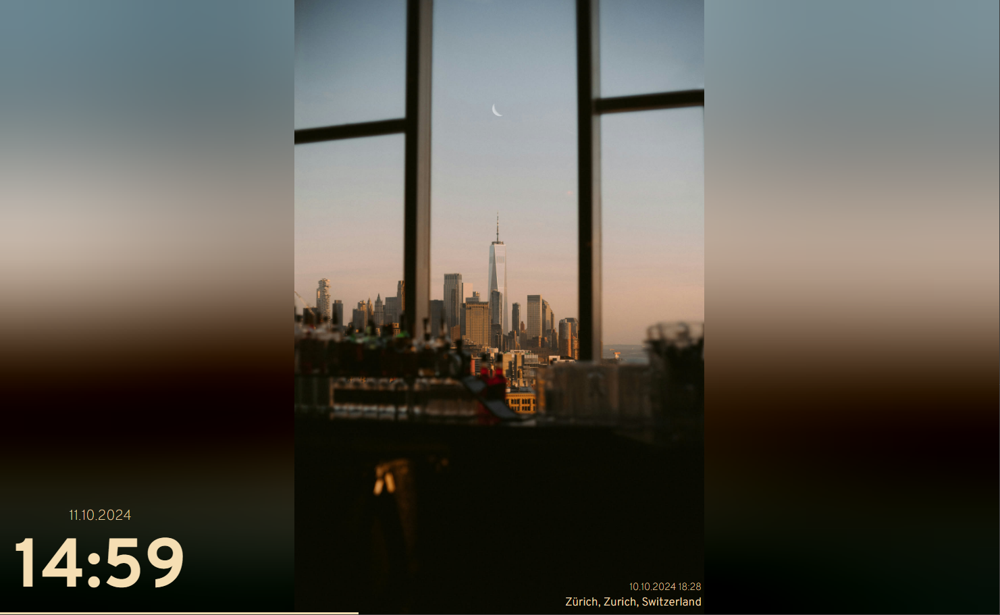

[![Contributors][contributors-shield]][contributors-url]
[![Forks][forks-shield]][forks-url]
[![Stargazers][stars-shield]][stars-url]
[![Issues][issues-shield]][issues-url]
[![MIT License][license-shield]][license-url]

<!-- PROJECT LOGO -->
<br />
<div align="center">
  <a href="https://github.com/3rob3/ImmichFrame">
    
  </a>

  <h3 align="center">ImmichFrame</h3>

  <p align="center">
    An awesome way to display your photos as a digital photo frame
    <br />
    <a href="https://immich.app/"><strong>Explore immich »</strong></a>
    <br />
    <br />
    <a href="https://immichframe.dev">Documentation</a>
    ·
    <a href="https://demo.immichframe.dev">Demo</a>
    ·
    <a href="https://github.com/immichFrame/ImmichFrame/issues">Report Bug</a>
    ·
    <a href="https://github.com/immichFrame/ImmichFrame/issues">Request Feature</a>
  </p>
</div>

## 📄 Documentation
You can find the documentation [here](https://immichframe.dev).

## 🖼️ Demo

You can find a working demo [here](https://demo.immichframe.dev).



## 🏛️ Architecture & How It Works

ImmichFrame follows a **two-tier companion architecture**:

```
┌──────────────────┐            ┌────────────────────────┐            ┌───────────────────────────┐
│                  │  API Key   │                        │  HTTP/LAN  │      Display Clients      │
│  Immich Server   │ ◄────────► │   ImmichFrame Server   │ ◄────────► │  • Web Browser / PWA      │
│ (Photo Library)  │            │   (Docker Container)   │            │  • Android App / TV       │
│                  │            │                        │            │  • Apple TV / iPad / iOS  │
└──────────────────┘            └────────────────────────┘            └───────────────────────────┘
```

> [!IMPORTANT]
> **Display devices and apps connect to the ImmichFrame server, NOT directly to your Immich server.**
> ImmichFrame acts as the companion service that communicates with your Immich library, manages caching, selects photos, and serves the slideshow to your display screens.

1. **Immich Server**: Your existing self-hosted Immich instance holding your photos and videos.
2. **ImmichFrame Server (this repository)**: A backend container (typically deployed via Docker) that connects to Immich using an API key. It serves the built-in web client and the `/admin` configuration UI.
3. **Display Clients**: The screen(s) showing your photo frame:
   - **Web Browser / PWA**: Open `http://<immichframe-ip>:8080` on any browser, smart display, or Raspberry Pi.
   - **[Android App & Screensaver][github-android-repo]**: Dedicated app for Android tablets, Google TV, Android TV, and digital photo frames ([Google Play][play-store-link] or [GitHub Releases][github-android-releases]).
   - **[Apple TV & iOS App][github-apple-repo]**: Available on the [Apple App Store][app-store-link] for Apple TV, iPad, and iPhone.

## 🚀 Quick Start

1. **Deploy ImmichFrame Server** using Docker Compose:
   ```yaml
   services:
     immichframe:
       container_name: immichframe
       image: ghcr.io/immichframe/immichframe:latest
       restart: on-failure
       ports:
         - "8080:8080"
       environment:
         TZ: "Europe/Berlin"
         IMMICHFRAME_ADMIN_PASSWORD: "CHANGE_ME"
   ```
2. **Configure Immich Connection**:
   Open `http://<immichframe-ip>:8080/admin` in your browser to sign in and enter your Immich server URL, API key, and slideshow preferences (or use a `Settings.yml`/`Settings.json` file).
3. **View Slideshow**:
   Open `http://<immichframe-ip>:8080` on your display device or connect via the Android/Apple apps.

For advanced configuration, weather overlays, and multi-user setups, check out the **[Documentation](https://immichframe.dev)**.

## ⚠️ Disclaimer

**This project is not affiliated with [immich][immich-github-url]!**

## 📜 License

[GNU General Public License v3.0](LICENSE.txt)

## 🆘 Help

[Discord Channel][support-url]

## 🙏 Acknowledgments

- BIG thanks to the [immich team][immich-github-url] for creating an awesome tool

## 🌟 Star History

[](https://star-history.dera.page/#immichframe/immichframe&Date)

<!-- MARKDOWN LINKS & IMAGES -->
<!-- https://www.markdownguide.org/basic-syntax/#reference-style-links -->

[contributors-shield]: https://img.shields.io/github/contributors/immichFrame/ImmichFrame.svg?style=for-the-badge
[contributors-url]: https://github.com/immichFrame/ImmichFrame/graphs/contributors
[forks-shield]: https://img.shields.io/github/forks/immichFrame/ImmichFrame.svg?style=for-the-badge
[forks-url]: https://github.com/immichFrame/ImmichFrame/network/members
[stars-shield]: https://img.shields.io/github/stars/immichFrame/ImmichFrame.svg?style=for-the-badge
[stars-url]: https://github.com/immichFrame/ImmichFrame/stargazers
[issues-shield]: https://img.shields.io/github/issues/immichFrame/ImmichFrame.svg?style=for-the-badge
[issues-url]: https://github.com/immichFrame/ImmichFrame/issues
[license-shield]: https://img.shields.io/github/license/immichFrame/ImmichFrame.svg?style=for-the-badge
[license-url]: https://github.com/immichFrame/ImmichFrame/blob/master/LICENSE.txt
[releases-url]: https://github.com/immichFrame/ImmichFrame/releases/latest
[support-url]: https://discord.com/channels/979116623879368755/1217843270244372480
[openweathermap-url]: https://openweathermap.org/
[immich-github-url]: https://github.com/immich-app/immich
[immich-api-url]: https://immich.app/docs/features/command-line-interface#obtain-the-api-key
[play-store-link]: https://play.google.com/store/apps/details?id=com.immichframe.immichframe
[github-android-repo]: https://github.com/immichFrame/ImmichFrame_Android
[github-android-releases]: https://github.com/immichFrame/ImmichFrame_Android/releases
[github-apple-repo]: https://github.com/immichFrame/ImmichFrame_Apple
[app-store-link]: https://apps.apple.com/us/app/immichframe/id6742748077
